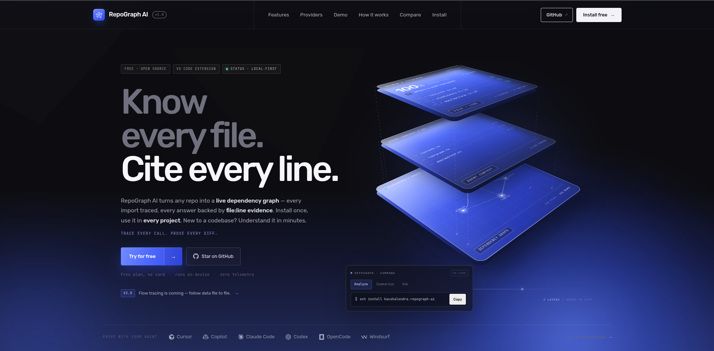
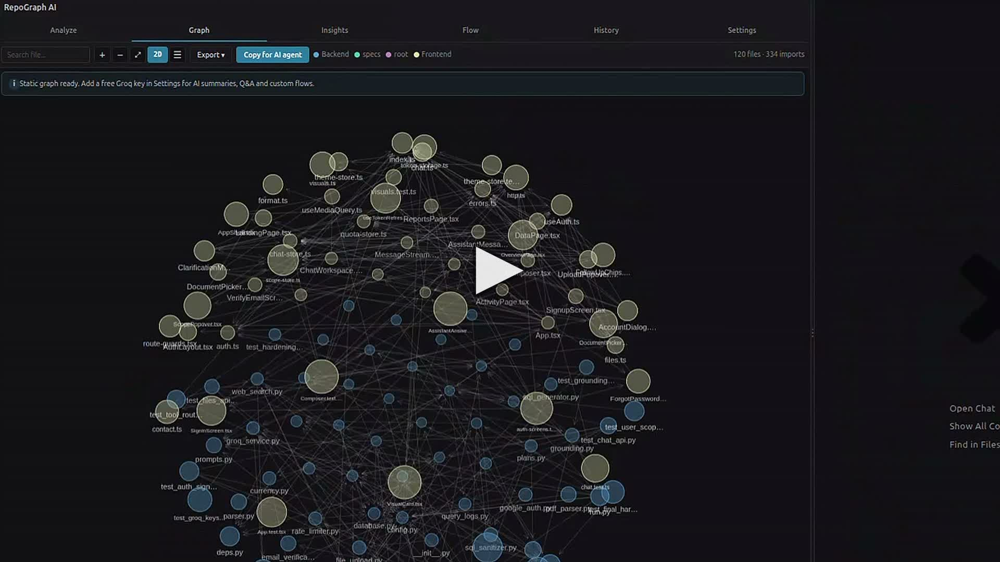
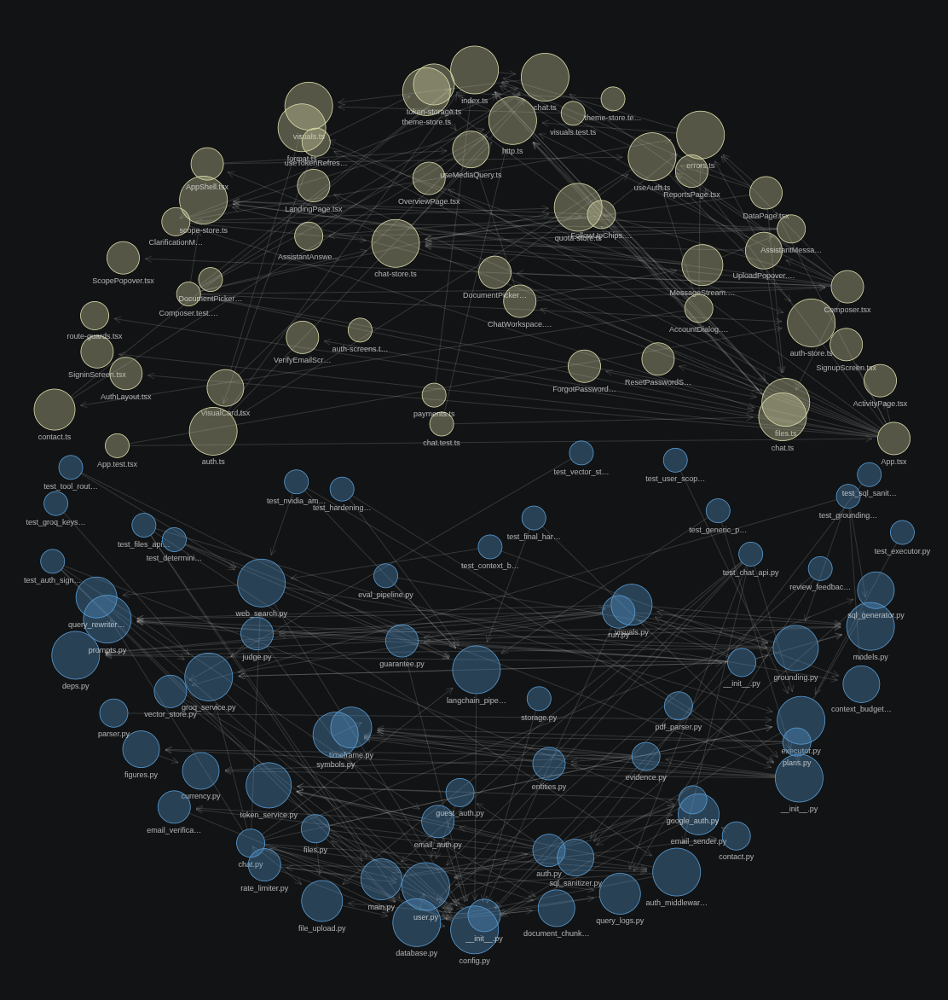
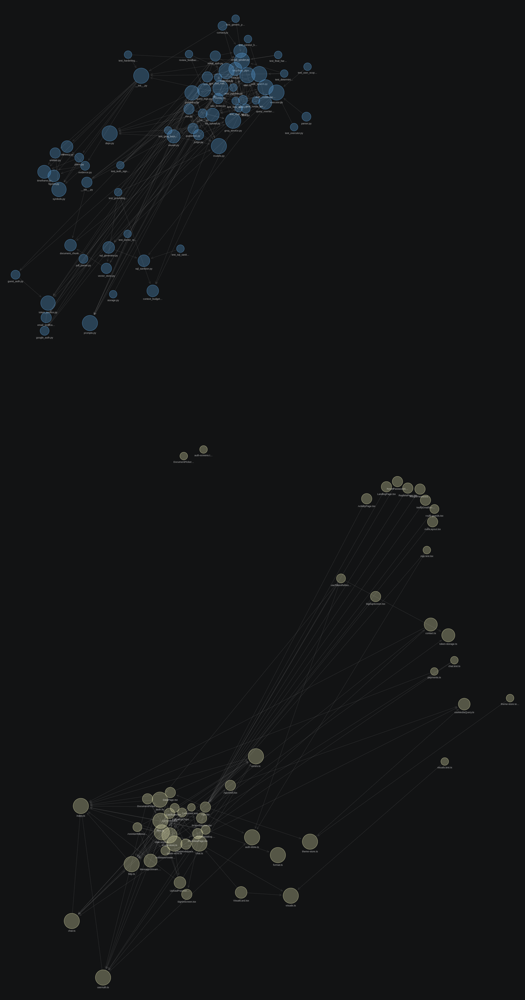
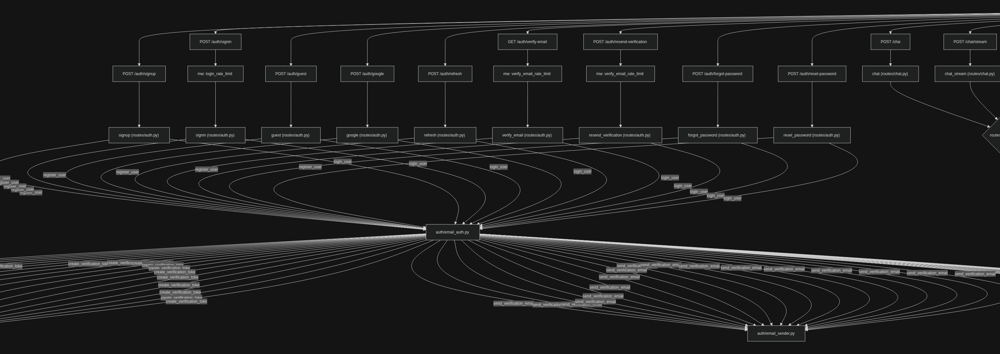
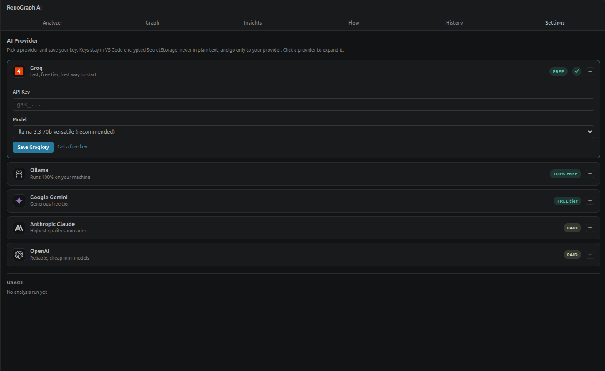

<div align="center">


# RepoGraph AI

[](https://repograph.kaushalendra.me/)

**Understand any codebase in minutes, not days — with one click.**

A VS Code extension that auto-indexes your workspace the moment you open it, maps every file
relationship with provenance-tracked edges, renders 2D/3D dependency graphs and multi-dialect
flow diagrams, answers questions about your code with citations, and exports an AI graph —
compact context file your coding agent can read instead of re-scanning your repo — all running
locally, on your machine.

**Know every file. Cite every line.**

**🌐 [repograph.kaushalendra.me](https://repograph.kaushalendra.me/)** — website, docs & guides

[](LICENSE)
[](https://marketplace.visualstudio.com/items?itemName=repograph.repograph-ai)
[](https://github.com/Kaushalendra-Marcus/RepoGraph-AI)
[](https://repograph.kaushalendra.me/)

[Website](https://repograph.kaushalendra.me/) · [Install](#installation) · [Quick Start](#quick-start) · [Features](#features-in-depth) · [Compare](#compare) · [Report a Bug](https://github.com/Kaushalendra-Marcus/RepoGraph-AI/issues)

</div>

---

## Demo

<div align="center">

<a href="https://repograph.kaushalendra.me/#demo">
  
</a>

**▶ Click to watch the 57-second walkthrough** — one-click analysis → the dependency graph → the data-flow map → the context file your AI agent gets. Hosted on the [website](https://repograph.kaushalendra.me/).

</div>

**The walkthrough's five chapters:**

| # | At | Chapter |
|:---:|:---:|---|
| 01 | 0:00 | Analyze workspace |
| 02 | 0:06 | Dependency graph |
| 03 | 0:30 | Data flow |
| 04 | 0:40 | Agent context file |
| 05 | 0:51 | Your own AI provider |

---

## Why RepoGraph AI

RepoGraph AI turns any repository into an **AI coding agent graph** — a machine-readable map with
files as nodes and imports & calls as typed edges, so both you and your AI agent can navigate,
summarize, and question the codebase with full structural context. Most code-graph tools ask you
to run a CLI, index a database, or open a browser tab. RepoGraph AI takes a different path:

- **Zero setup.** Open any folder and the graph builds itself — no CLI, no config files, no per-project reruns, no terminal.
- **Honest by design.** Every edge carries a provenance label — `EXTRACTED` (read directly from source), `INFERRED` (derived by analysis), or `AMBIGUOUS` (uncertain, low confidence). The graph always tells you what it *knows* versus what it *guessed*.
- **AI optional.** The full graph, flow diagrams, guided tour, health report, and agent-context export all work with **no API key at all**. Add a key only when you want AI-written summaries and Q&A.
- **Agent-ready.** One click exports `REPOGRAPH-CONTEXT.md` — a compact, factual snapshot your coding agent reads instead of burning tokens re-scanning the whole repo. Fewer tokens, fewer hallucinated imports, fewer "fixes" that undo things you already fixed.
- **Private.** No telemetry, no backend, no account. Everything except the optional AI call runs on your machine.

**Who it's for:** indie hackers · freelancers · OSS maintainers · students · startup teams ·
agencies · enterprises · researchers — anyone who reads code, especially on day one of a new codebase.

---

## The Panel — A Tour

RepoGraph AI lives in a sidebar panel with six tabs. Here is what each one does, top to bottom.

### 1 · Analyze

The command center. Shows the current workspace, provider status, and a single
**Analyze Workspace** button that walks a visible 5-step pipeline — scan files → build graph →
repo summary → file summaries → flow diagrams — with live progress and status after each step.
After the run you get the agent-context export card here (one click to save `REPOGRAPH-CONTEXT.md`).

### 2 · Graph

An interactive, force-directed map of your workspace: every file is a node, every import an edge.

- **Search** any file by name; hover to highlight its connections; drag and zoom freely.
- **Click a node** to open a detail panel: what this file imports, what imports it, its language, size, and a **one-click jump to the file in your editor**.
- **2D ↔ 3D toggle** — flip the same graph onto a 3D sphere with perspective depth. Same nodes, same edges, same sizes; drag rotates the globe, shift-drag pans, scroll zooms. Big repos stay readable because every node renders near-equal on the sphere.
- **Friend-link detection**: edges needing inference (aliases, path shims, call chains) are labeled and counted, so you always know how much of the picture is hard evidence.

### 3 · Insights (summaries + Q&A)

The reading tab — and the thinking one.

- **Repo overview**: plain-English overview, architecture description, tech stack, entry points, and key modules — with a heuristic version available even with no API key.
- **File cards**: the most important files, each with its purpose, exports, and key functions. No more opening random files to find where things live.
- **Q&A chat**: ask anything — *"where is authentication handled?"*, *"which files touch the database?"*, *"how does routing work?"*. The agent expands your question against the codebase's actual vocabulary, walks the dependency graph up to **3 hops**, keeps the answer within a token budget, and **cites the files it used**. Multi-turn, with history — paste any answer straight into your agent. When the graph can't support an answer, it says so instead of inventing one.
- **Agent-context export** button lives here too.

### 4 · Flow

Auto-generated flow diagrams of how the system actually behaves — rendered as tiles you click to open full-size.

- **Preset questions** (API request, Auth flow, Component data, DB writes…) plus a free-text box: *"how does checkout work?"* generates a custom diagram grounded in your code.
- **Multiple dialects, picked automatically** — flowcharts, sequence diagrams, class diagrams, and single-function control flow (see [Flow Diagrams](#flow-diagrams) below).
- **Guided tour** — a recommended reading order across diagrams for newcomers.
- **Click-to-line chips** — related files carry exact `file:line` targets; clicking one opens the editor scrolled there.
- **Exports** — save any diagram as `.mmd` (git-diffable Mermaid), `.svg`, or `.json`.

### 5 · History

Every analysis is a named, timestamped snapshot stored locally. Reload any past analysis to
compare how the codebase looked before and after a refactor, and delete records you no longer need.

### 6 · Settings

Pick one of five AI providers, paste a key (stored in VS Code's encrypted `SecretStorage`),
choose/change model names, and toggle auto-indexing. Keys never leave your machine.

---

## Screenshots

| Dependency Graph (3D) | Communities (2D) |
|:---:|:---:|
|  |  |
| The whole repo on a sphere — frontend (gold) and backend (blue) hemispheres, hover to trace imports | In 2D the same graph falls apart into natural clusters — backend and frontend separate on their own |
| **Complete data-flow** | **Settings** |
|  |  |
| Every route → middleware → handler → next hop, exported from the Flow tab — saved as `.mmd`/`.svg`/`.json` with one click | Five AI providers with recommended models, FREE/PAID badges — keys stay in VS Code encrypted SecretStorage |

---

## Features In Depth

### One-Click Auto-Index

The defining feature: **you never run anything**.

- Open a folder → RepoGraph scans it and builds the graph within seconds. The status bar shows live index state.
- A `FileSystemWatcher` watches your code files; save a change and the graph updates after a short ~1.5 s debounce — always current, never in your way. No per-project config, no server to keep running: install once, open any folder, hit **Analyze Workspace**, and the graph is ready in seconds — switch projects and repeat, same flow every time.
- Results are cached to disk with a **content-hashed manifest**: on reopen, only files whose contents actually changed are reprocessed, so the same project loads near-instantly (cache lives in VS Code's storage dir; no artifacts polluting your repo).
- Manual control whenever you want it: `RepoGraph AI: Reindex Workspace` forces a full rebuild, and the `repograph.autoIndex` setting can turn the magic off.

### Provenance Dependency Graph

Not just *that* things connect, but *how we know*:

| Edge label | Meaning | Confidence |
|---|---|---|
| `EXTRACTED` | Parsed directly from a real `import`/`require`/`use` statement | 1.0 |
| `INFERRED` | Resolved through aliases, call chains, or heuristics | 0.85 |
| `AMBIGUOUS` | Multiple candidates or unresolved path | 0.3 |

On top of that evidence model, the builder computes:

- **God nodes** — files whose change ripples widest, ranked by degree.
- **Blast radius** — pick any file and see everything reachable within 2 hops *before* you refactor it.
- **Communities** — the graph is clustered into natural modules, so large repos don't turn into hairballs.
- **Health report** — automatic diagnosis with warnings (hub overload, orphan clusters, high ambiguity rate) and a shareable graph report.

### Flow Diagrams

One diagram type is never enough, so RepoGraph picks the right dialect per question:

| Diagram | What it shows | Built from |
|---|---|---|
| **Flowchart** | End-to-end system flow, module hubs, component/data/auth flows | Routes, call chains, DB access, events |
| **Sequence** | Ordered request lifecycle: client → handler → middleware → service → DB → response | Real routes + middleware stacks + call chains |
| **Class** | Classes, interfaces, and `uses` relationships | File summaries + import edges |
| **Function control flow** | Branches, loops, try/catch, and DB/emit markers inside one function — every node tagged with `file:line` | On-demand extraction (enter file + function name) |

The end-to-end flow and the sequence + class diagrams are **deterministic** — computed from
static analysis, never from a language model — so they exist even with no API key and are always
trustworthy. When AI generates additional diagrams, they pass through safeguards that generic
diagram generators skip:

- **Grounding validator** — every node label must match a real route, symbol, file, or method from the static index. Invented labels are dropped; a diagram falling below a minimum edge count is rejected and replaced with the deterministic fallback. The AI can decorate, but it cannot invent.
- **Cycle fixer** — self-loops and malformed edges are repaired before rendering.
- **Guided tour** — diagrams are ordered into an onboarding path: end-to-end first, then request order, API surface, data layer, auth — up to six steps.
- **Health badges** — tiles touching god files get a visible risk badge.

### Agent Context Export — the Token Saver

One click writes `REPOGRAPH-CONTEXT.md` to your workspace root, ready to paste into (or be read
by) any coding agent — Copilot, Cursor, Claude Code, Codex, OpenCode, Windsurf, Cline — instead
of letting it re-scan the repo. The export reports its approximate token count and estimated
savings vs. raw source.

What's inside:

- Overview, architecture, tech stack, entry points, key modules
- Top 15 files with purpose + exports
- Key symbols with `file:line` locations, ranked by export status and hub centrality
- The 60 most central dependency edges (a hub neighbourhood, not a 250-line dump)
- Routes, call chains, data access, events, middleware
- Up to six flow diagrams embedded as Mermaid
- Compact, noise-filtered file tree

And one line agents need to hear:

> *Note for agents: imports above are a static-analysis snapshot, not verified ground truth.
> Cross-check by reading source files before refactoring.*

That single line — plus grounded, `file:line`-referenced facts — is what stops agents from
re-fixing things you already fixed and importing modules that don't exist.

### Works With or Without an API Key

| Capability | No key (static mode) | With AI |
|---|---|---|
| Dependency graph + provenance + god nodes | ✅ | ✅ |
| 2D / 3D views | ✅ | ✅ |
| Flow diagrams (flowchart, sequence, class, function) | ✅ deterministic | ✅ + AI-generated extras, validated |
| Guided tour + health badges | ✅ | ✅ |
| `REPOGRAPH-CONTEXT.md` export | ✅ (facts only) | ✅ + AI prose sections |
| Repo & file summaries | Heuristic | AI-written |
| Q&A in Insights | — | ✅ |

---

## Installation

**From the VS Code Marketplace:**

Search `RepoGraph AI` in the Extensions panel (`Ctrl+Shift+X`) and click Install — or paste this
into the Command Palette:

```text
ext install kaushalendra.repograph-ai
```

**From a `.vsix` file:**

```bash
code --install-extension repograph-ai-1.0.0.vsix
```

---

## Quick Start

**Step 1 — Open a project.** That's it. The graph builds itself within seconds of opening a
folder — watch the status bar. No CLI, no setup, no per-project reruns.

**Step 2 — Explore immediately (no key needed):**

- **Graph tab** — dependency map with provenance, god nodes, and the 2D/3D toggle
- **Flow tab** — end-to-end, sequence, and class diagrams with a guided tour
- Export **`REPOGRAPH-CONTEXT.md`** for your coding agent from Analyze or Insights

**Step 3 — (Optional) Add AI.** Open the RepoGraph panel → **Settings** → pick a provider →
paste your key. It's stored encrypted via your OS keychain and never leaves your machine.
Start free with Groq: https://console.groq.com/keys

**Step 4 — Analyze with AI.** Click **Analyze Workspace** for AI summaries and full Q&A.
Most repos of 50–500 files finish in under a minute.

**Commands & settings:**

| Item | What it does |
|---|---|
| `Ctrl+Shift+P → RepoGraph AI: Open Panel` | Focus the RepoGraph sidebar |
| `RepoGraph AI: Reindex Workspace` | Force a full graph rebuild |
| `repograph.autoIndex` (setting, default `true`) | Auto-build/update the graph on folder open and file save |

---

## Supported AI Providers

Works with the provider you already pay for. All five support custom model names, keys stay in
your keychain, and switching providers never requires re-analyzing your workspace.

| Provider | Cost | Default model | Best for | Auth |
|---|---|---|---|---|
| **Groq** | Free tier | `llama-3.3-70b-versatile` | Instant answers. Fast LPU-backed cloud inference; generous free limits to start. | API key |
| **Ollama** | Completely free | `qwen3` on `http://localhost:11434` | Offline privacy. Run open models on your own machine — no key, no cloud, no source code leaving the laptop. | None required |
| **Google Gemini** | Free quota | `gemini-2.5-flash` | Long context for whole-repo questions. The free quota is enough to get started. | API key |
| **Anthropic Claude** | Paid | `claude-sonnet-4-5` | Careful reasoning and precise `file:line` citations for complex refactors and deep codebases. | API key |
| **OpenAI** | Paid | `gpt-4o-mini` | Battle-tested consistency for summaries, Q&A and docs at scale. | API key |

Model names are configurable per provider via `repograph.<provider>.model` (e.g.
`repograph.groq.model`) and `repograph.<provider>.baseUrl` (e.g. for Ollama).

---

## Supported Languages

20+: TypeScript · JavaScript · Python · Go · Rust · Java · Kotlin · C/C++ · C# · Ruby · PHP · Swift · Vue · Svelte · Astro · GraphQL · Prisma · SQL · Shell

---

## Compare

Graphs, grep, or review bots? The usual shortlist for reading a repo — and what each tool actually does inside yours. *(Also on the [website](https://repograph.kaushalendra.me/).)*

| Compared on | RepoGraph AI | Sourcegraph | Greptile | CodeRabbit |
|---|:---|:---|:---|:---|
| Runs on your machine | ✅ parsing stays in the editor | ❌ cloud index | ❌ cloud SaaS | ❌ cloud SaaS |
| Every import, mapped | ✅ interactive graph + god nodes | ✳️ search-first code intel | ❌ graph, but review-only | ❌ diffs, not a graph |
| Works fully offline | ✅ with Ollama, zero cloud | ❌ needs the cloud | ❌ needs the cloud | ❌ needs the cloud |
| Any AI provider (BYO key) | ✅ Groq · Ollama · Gemini · Claude · OpenAI | ❌ built-in models only | ❌ built-in only | ❌ built-in only |
| Ready in one install | ✅ open any repo → it analyzes | ❌ index a repo first | ❌ connect repo, wait on index | ❌ install the GitHub app |
| Install once, use in any project | ✅ no per-repo setup | ❌ index each repo first | ❌ connect repo by repo | ❌ set up per repo |
| Open source (MIT) | ✅ auditable, forkable | ✳️ open clients, closed core | ❌ proprietary | ❌ proprietary |
| Free to start | ✅ free — bring your key | ✳️ free tier → paid teams | ❌ paid per dev | ✳️ free for OSS → paid |

---

## How It Works

```
Open Workspace
      |
Auto-Index (extension.ts + RepoGraphPanel)
  - Immediate scan on folder open (debounced ~1.5 s)
  - FileSystemWatcher keeps the graph live on save
  - Disk cache (GraphCache): content-hashed manifest,
    incremental diff → instant reopen, rebuild only what changed
      |
WorkspaceScanner
  - Reads all source files, skips generated/build outputs
      |
GraphBuilder (provenance graph)
  - extractSymbols() → exported functions/classes with file:line
  - resolveImportWithProvenance() → EXTRACTED / INFERRED / AMBIGUOUS edges
  - Call-chain edges, community detection, god nodes,
    blast radius (2-hop), health diagnosis
      |
FlowAnalyzer
  - Extracts routes, middleware, DB access, events, call chains
      |
FlowDiagramAgent
  - Deterministic builders: end-to-end flowchart, sequence, class, function CFG
  - Optional AI diagrams → grounding validator + cycle fixer
  - Guided tour ordering + health badges
      |
AI Agents (your API key — optional)
  - RepoSummaryAgent → overview, architecture, tech stack
  - FileSummaryAgent → per-file purpose and exports (batched)
  - QAAgent          → vocab-constrained graph traversal Q&A with citations
      |
Webview Panel (6 tabs)
  Analyze · Graph · Insights · Flow · History · Settings
```

The entire pipeline runs locally. The only external call is to the AI provider you choose.

---

## Project Structure

```
repograph-ai/
├── src/
│   ├── extension.ts                # Entry point: auto-index, watcher, status bar, commands
│   ├── providers/
│   │   ├── types.ts                # AIProvider interface
│   │   ├── GroqProvider.ts         # + Ollama, Gemini, Anthropic, OpenAI providers
│   │   └── index.ts                # Provider registry
│   ├── analyzer/
│   │   ├── WorkspaceScanner.ts     # File discovery and content reading
│   │   ├── GraphBuilder.ts         # Provenance graph: symbols, typed edges, communities,
│   │   │                           #   god nodes, blast radius, health, report
│   │   ├── GraphCache.ts           # Disk cache: content hash, manifest diff, load/save
│   │   ├── FlowAnalyzer.ts         # Route/middleware/DB/event/call-chain extraction
│   │   └── RepoFetcher.ts          # Remote-repo helpers
│   ├── agents/
│   │   ├── RepoSummaryAgent.ts     # Repo-level overview (+ heuristic fallback)
│   │   ├── FileSummaryAgent.ts     # Per-file summaries (+ heuristic fallback)
│   │   ├── FlowDiagramAgent.ts     # Diagram builders, grounding validator, guided tour
│   │   └── QAAgent.ts              # Traversal Q&A with citations
│   └── panel/
│       ├── RepoGraphPanel.ts       # WebviewViewProvider + auto-index orchestration
│       ├── handlers/               # Analysis, Flow, File, Export, History, Settings
│       └── webview/                # Tab HTML, scripts (graph/flow/messaging/ui), styles
├── docs/                           # Architecture deep-dives (see docs/README.md)
├── scripts/build-webview.js        # Assembles the webview bundle
├── public/                         # Icon, demo poster, logos, screenshots
├── package.json                    # Extension manifest
└── tsconfig.json
```

---

## Development

**Prerequisites:** Node.js 18+, VS Code 1.85+

```bash
git clone https://github.com/Kaushalendra-Marcus/RepoGraph-AI
cd repograph-ai
npm install
npm run compile
```

Press `F5` in VS Code to open the Extension Development Host with the extension loaded.

`npm run compile` runs two steps: TypeScript compilation (`tsc -p ./`) and the webview bundle
build (`node scripts/build-webview.js` → `out/webview-bundle.html`). The webview is assembled
from separate source files under `src/panel/webview/` — edit those, not the bundle.

**Watch mode** (recompiles on save):

```bash
npm run watch
```

**Package for distribution:**

```bash
npm install -g @vscode/vsce
npm run compile
vsce package
```

This produces a `.vsix` file you can share or install locally.

---

## Documentation

Deeper dives live in [`docs/`](docs/README.md) and on the
[website](https://repograph.kaushalendra.me/):

| Doc | Topic |
|---|---|
| [01-architecture](docs/01-architecture.md) | Extension structure and message flow |
| [02-graph](docs/02-graph.md) | Provenance graph, god nodes, blast radius |
| [03-flow-diagrams](docs/03-flow-diagrams.md) | Flow tab, diagram kinds, grounding validator |
| [04-summary](docs/04-summary.md) | Repo & file summary agents |
| [05-qa](docs/05-qa.md) | Traversal Q&A design |
| [06-ai-tools](docs/06-ai-tools.md) | AI tool integrations |
| [07-settings-providers](docs/07-settings-providers.md) | Provider configuration |
| [08-history](docs/08-history.md) | Analysis snapshots |
| [09-analysis-pipeline](docs/09-analysis-pipeline.md) | The 5-step pipeline end to end |
| [10-design-ui](docs/10-design-ui.md) | Webview design system |

---

## FAQ

**Is RepoGraph AI really free?**
Yes — 100% free and MIT-licensed. Bring your own key from Groq (free tier) or Ollama (fully local). No subscription, no account, no paywall.

**Does my code get sent to a server?**
No. There is no backend. The only external call is to the AI provider you configure. Everything else stays on your machine.

**Which AI providers are supported?**
Groq, Ollama, Gemini, Claude and OpenAI — with custom model names. Switch providers anytime without re-analyzing.

**What is an AI coding agent graph?**
A machine-readable map of a repository: files as nodes, imports and calls as typed edges. RepoGraph AI builds exactly this graph for any repo, so both you and an AI coding agent can navigate, summarize, and question the codebase with full structural context.

**Can coding agents use the RepoGraph agent graph?**
Yes. Export `REPOGRAPH-CONTEXT.md` and point your agent at it (Cursor, Copilot, Claude Code, Codex, OpenCode, Windsurf, Cline) — cited structure in, no wasted tokens re-reading files. v2.0 goes further: the flow tracer will export the repo graph as typed trace records agents can consume directly.

**How large a codebase can it handle?**
Files are processed in batches with generated code skipped. Most repos of 50–500 files finish in under a minute.

**I'm new to a project. Where do I start?**
Analyze the workspace once: the dependency graph shows you what connects to what, the repo overview explains the architecture, and Q&A answers "where is X handled?" with file references. Most developers go from zero to productive in a single sitting.

**How is it different from other repo graph tools?**
Most repo graph tools only draw static pictures. RepoGraph AI combines a live dependency graph, per-file AI summaries, multi-turn codebase Q&A, five AI providers, and zero telemetry — free and open source, entirely inside VS Code.

**Which languages are supported?**
20+: TypeScript, JavaScript, Python, Go, Rust, Java, Kotlin, C/C++, C#, Ruby, PHP, Swift, Vue, Svelte, Astro, GraphQL, Prisma, SQL, Shell.

**Why did my AI diagram disappear after analysis?**
The grounding validator rejected it — its labels didn't match real routes, symbols, files, or methods in your repo. The deterministic fallback you see instead is the honest version.

---

## Roadmap · v2.0

**Flow tracing is coming** — not just what a file imports, but where each value travels:

- **Hop-by-hop tracer** — walks call edges across files, every hop declaring its input and output, so the whole path is auditable.
- **`trace.json` artifact** — the full path saved per workspace; diff it across refactors, and let coding agents consume the typed trace records directly.
- **Flow view in-panel** — click any hop to jump straight to the line.

Follow the [GitHub repo](https://github.com/Kaushalendra-Marcus/RepoGraph-AI) to catch the release.

---

## Privacy

Your code never leaves your machine. No backend. No account. No tracking. The only network
request is to the AI provider you configure.

| Data | Where it goes |
|---|---|
| Your workspace | Analyzed locally, in VS Code only |
| Graph + summaries | Local storage |
| File snippets | AI provider only (the one you configure) |
| Our servers | ✕ do not exist |
| Analytics | ✕ none |
| Account required | ✕ never |

Key guarantees:

- **Encrypted key storage** — keys live in VS Code `SecretStorage` via the OS keychain; never plaintext on disk
- **Zero telemetry** — no analytics, no crash reports; fully offline except AI calls
- **Open source & auditable** — every line public on GitHub; read it, verify it, fork it
- Everything except the optional AI call runs entirely on your machine — scanning, graph
  building, flow extraction, caching, and exports are all local

---

## Creator

Built by a dev, for devs. No team, no roadmap committee: RepoGraph AI is designed, built, and
maintained in the open by **Kaushalendra Yadav** — AI engineer building tools that make
codebases legible, and the person behind every release.

[GitHub](https://github.com/Kaushalendra-Marcus/RepoGraph-AI) · [Marketplace](https://marketplace.visualstudio.com/items?itemName=repograph.repograph-ai) · [Website](https://repograph.kaushalendra.me/)

---

## Contributing

Contributions are welcome. This project is MIT licensed and open to everyone.

Read [CONTRIBUTING.md](CONTRIBUTING.md) to get started. For significant changes, please open an
issue first to discuss what you'd like to change.

**Good first issues:**

- Adding support for a new programming language in `GraphBuilder.ts`
- Improving import resolution accuracy
- Deepening the function control-flow extraction (e.g. structured CFG instead of regex)
- Adding new suggested questions in the Q&A tab

---

## Changelog

See [CHANGELOG.md](CHANGELOG.md) for the full history.

---

## License

MIT — free to use, modify, and distribute. See [LICENSE](LICENSE) for details.

---

<div align="center">

**Stop reading files. Start understanding code.** ★★★★★ Loved by devs onboarding to new codebases

**[Install from the Marketplace](https://marketplace.visualstudio.com/items?itemName=repograph.repograph-ai)** — free, open source, no account

**[repograph.kaushalendra.me](https://repograph.kaushalendra.me/)** · MIT © 2026 Kaushalendra Yadav

</div>
