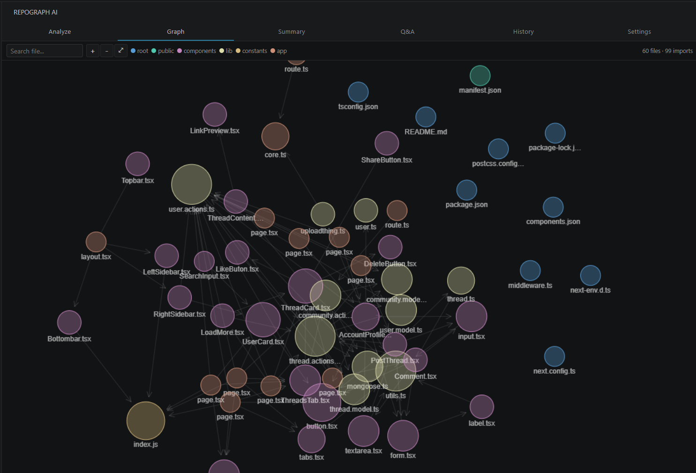
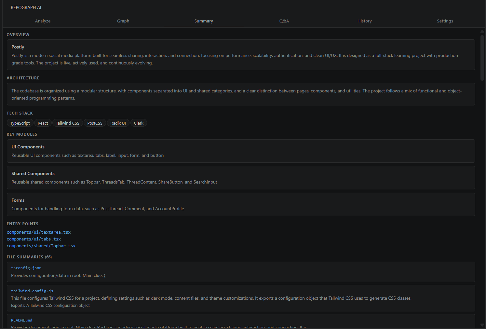
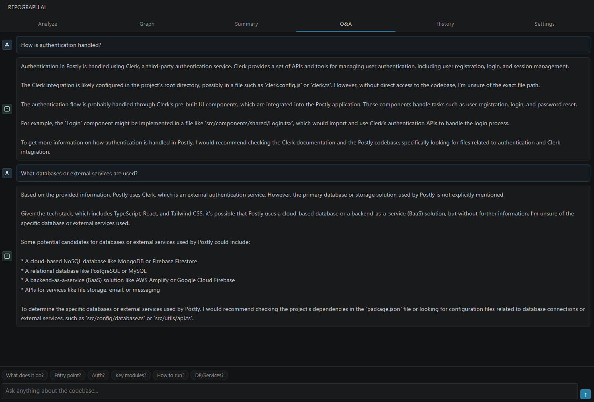

<div align="center">


# RepoGraph AI

**Understand any codebase in minutes, not days — with one click.**

A VS Code extension that auto-indexes your workspace the moment you open it, maps every file
relationship with provenance-tracked edges, renders 2D/3D dependency graphs and flow diagrams,
answers questions about your code, and exports a compact context file for your AI coding agent —
all running locally on your machine.

[](LICENSE)
[](https://marketplace.visualstudio.com/items?itemName=repograph.repograph-ai)
[](https://github.com/Kaushalendra-Marcus/CodeGraph-AI)

[Install](#installation) · [Quick Start](#quick-start) · [Features](#features) · [How It Works](#how-it-works) · [Report a Bug](https://github.com/Kaushalendra-Marcus/CodeGraph-AI/issues)

</div>

---

## Why RepoGraph AI

When you join a new project or explore open source, the hardest part is not reading individual
files — it's understanding how everything connects. Most code-graph tools solve this by asking
you to run a CLI, index a database, or open a browser tab. RepoGraph AI takes a different path:

- **Zero setup.** Open a folder and the graph builds itself. No CLI, no config files, no per-project reruns.
- **Honest by design.** Every edge carries a provenance label — `EXTRACTED` (read directly from source), `INFERRED` (derived by analysis), or `AMBIGUOUS` (uncertain, low confidence). The graph tells you what it knows and what it guessed.
- **AI optional.** The full graph, flow diagrams, health report, and agent context export work with **no API key at all**. Add a key only when you want AI summaries and Q&A.
- **Agent-ready.** One click exports `REPOGRAPH-CONTEXT.md` — a compact, factual snapshot your coding agent reads instead of re-scanning the whole repo, saving tokens and preventing hallucinated imports.

---

## Features

### One-Click Auto-Index

Open any folder and RepoGraph AI immediately scans it, builds the dependency graph, and prepares
summaries and flow diagrams — before you click anything. A file watcher keeps the graph live:
save a file and the graph updates within ~1.5 seconds (debounced). Results are cached to disk,
so reopening the same project is instant until files actually change. A status-bar item shows
index state at a glance, and `RepoGraph AI: Reindex Workspace` forces a rebuild anytime.

> Disable anytime with the `repograph.autoIndex` setting.

### Provenance Dependency Graph

An interactive force-directed graph of every file and its import relationships — with an
evidence model behind it:

- **Edge provenance** — `EXTRACTED` (1.0 confidence, parsed from source), `INFERRED` (0.85, resolved through heuristics or call chains), `AMBIGUOUS` (0.3, flagged for review).
- **God nodes** — files whose change ripples widest, ranked by in/out degree.
- **Blast radius** — pick a file, see everything reachable within 2 hops before you refactor it.
- **Communities** — the graph is clustered into modules so large repos stay readable.
- **Health report** — automatic warnings (orphan clusters, hub overload, ambiguity rate) with a diagnosis you can export.

### 2D / 3D Graph Views

Same nodes, same edges, same interactions — flip a switch to project the graph onto a 3D sphere
with perspective depth. Drag to rotate, pan, zoom, search, and click any node for its imports,
importers, and a one-click jump to the file in the editor.

### Flow Diagrams

RepoGraph AI doesn't draw one diagram type and call it a day. It renders **three dialects** and
picks the right one per question:

| Diagram | What it shows | Built from |
|---|---|---|
| **Flowchart** | End-to-end system flow, module hubs, component/data/auth flows | Routes, call chains, DB access, events |
| **Sequence** | Ordered request lifecycle: client → handler → middleware → service → DB → response | Real routes + middleware stacks + call chains |
| **Class** | Classes, interfaces, and `uses` relationships | File summaries + import edges |
| **Function control flow** | Branches, loops, try/catch, DB and emit markers inside a single function — every node tagged with `file:line` | On-demand regex CFG extraction |

Built-in safeguards that generic diagram generators skip:

- **Grounding validator** — every AI-generated diagram is checked against the static index. Nodes whose labels don't match a real route, symbol, file, or method are dropped; diagrams that fall below a minimum edge count are rejected and replaced with a deterministic fallback. The AI can decorate, but it cannot invent.
- **Cycle fixer** — self-loops and malformed edges are repaired before rendering.
- **Guided tour** — diagrams are ordered into an onboarding path: end-to-end first, then request order, API surface, data layer, auth.
- **Health badges** — tiles are annotated when they touch god files, so risk is visible before you dive in.
- **Click-to-line** — related-file chips carry exact `file:line` targets; clicking one opens the editor scrolled to that line.
- **Export** — save any diagram as `.mmd` (git-diffable Mermaid), `.svg`, or `.json`.

Static flow detection works **without any API key**; AI adds richer diagrams on top when a key is configured.

### Agent Context Export (Token Saver)

One click writes `REPOGRAPH-CONTEXT.md` to your workspace root — a compact markdown snapshot
designed to be pasted into (or read by) any coding agent — Copilot, Cursor, Claude Code, Codex —
instead of letting it burn tokens re-scanning the repo:

- Overview, architecture, tech stack, entry points
- Top 15 files with purpose + exports
- Key symbols with `file:line` locations, ranked by export status and hub centrality
- The 60 most central dependency edges (not a 250-line dump)
- Routes, call chains, data access, events, middleware
- Flow diagrams as embedded Mermaid
- Compact file tree, noise-filtered

And one line agents need to hear:

> *Note for agents: imports above are a static-analysis snapshot, not verified ground truth. Cross-check by reading source files before refactoring.*

That single line — plus the grounded facts above — is what stops agents from re-fixing things
you already fixed and importing modules that don't exist. The export also reports approximate
token count and estimated savings vs. feeding raw source.

### Codebase Q&A with Graph Traversal

Ask questions in plain English — *"where is authentication handled?"*, *"which files talk to the
database?"*. The Q&A agent doesn't just stuff text into a prompt: it expands your question against
the codebase's actual vocabulary, walks the dependency graph up to 3 hops, and answers with
citations to specific files. When the graph can't support an answer, it says so instead of
hallucinating.

### AI Summaries & PR Review

- **Repo summary** — overview, architecture, tech stack, entry points, key modules.
- **File summaries** — per-file purpose, exports, and key functions (batched, budget-aware).
- **Refactor & PR review** — paste a diff and get a review weighted by blast radius: "this touches a god node, N files depend on it."

### Analysis History

Every analysis is saved locally. Reload a past snapshot to compare how the codebase looked
before and after a refactor, and delete records you no longer need.

### Smart File Filtering

Automatically skips `node_modules`, `dist`, `build`, `.git`, `__pycache__`, lockfiles, minified
bundles, and generated output — only real source code is analyzed.

---

## Works With or Without an API Key

| Capability | No key (static mode) | With AI |
|---|---|---|
| Dependency graph + provenance + god nodes | ✅ | ✅ |
| 2D / 3D views | ✅ | ✅ |
| Flow diagrams (flowchart, sequence, class, function) | ✅ deterministic | ✅ + AI-generated extras, validated |
| Guided tour + health badges | ✅ | ✅ |
| `REPOGRAPH-CONTEXT.md` export | ✅ | ✅ with AI prose sections |
| Repo & file summaries | Heuristic | AI-written |
| Q&A | — | ✅ |
| PR review | — | ✅ |

### Supported AI Providers

| Provider | Cost | Best for |
|---|---|---|
| **Groq** | Free tier | Best starting point. Fast, generous free limits. |
| **Ollama** | Completely free | Privacy-first. Runs 100% on your machine, no internet needed. |
| **Google Gemini** | Free tier available | gemini-1.5-flash has a good free quota. |
| **Anthropic Claude** | Paid | Highest quality answers and summaries. |
| **OpenAI** | Paid | gpt-4o-mini is cheap and reliable. |
| **VS Code Language Model** | Copilot plan | Zero-config fallback: if no key is set, custom flow generation can use Copilot models via `vscode.lm` when available. |

You can also type any custom model name manually for any provider.

---

## Supported Languages

TypeScript · JavaScript · Python · Go · Rust · Java · Kotlin · C · C++ · C# · Ruby · PHP · Swift · Vue · Svelte · Astro · GraphQL · Prisma · SQL · Shell

---

## Installation

**From the VS Code Marketplace:**

Search `RepoGraph AI` in the Extensions panel (`Ctrl+Shift+X`) and click Install.

**From a `.vsix` file:**

```bash
code --install-extension repograph-ai-1.0.0.vsix
```

---

## Quick Start

**Step 1 — Open a project.** That's it. The graph builds itself within seconds of opening a
folder — watch the status bar. No CLI, no setup, no per-project reruns.

**Step 2 — Explore immediately (no key needed):**

- **Graph tab** — dependency map with provenance, god nodes, and the 2D/3D toggle
- **Flow tab** — end-to-end, sequence, and class diagrams with a guided tour
- Export **`REPOGRAPH-CONTEXT.md`** for your coding agent

**Step 3 — (Optional) Add AI.** Open **Settings**, pick a provider, paste your key. It's stored
in VS Code's encrypted SecretStorage and never leaves your machine.
Get a free Groq key: https://console.groq.com/keys

**Step 4 — Analyze with AI.** Click **Analyze Workspace** for AI summaries, extra flow diagrams,
and full Q&A. A medium-sized project takes one to two minutes.

**Commands & settings:**

| Item | What it does |
|---|---|
| `RepoGraph AI: Open Panel` | Focus the RepoGraph sidebar |
| `RepoGraph AI: Reindex Workspace` | Force a full graph rebuild |
| `repograph.autoIndex` (setting, default `true`) | Auto-build/update the graph on folder open and file save |

---

## Screenshots

| Dependency Graph | File Summary | Q&A |
|---|---|---|
|  |  |  |

---

## How It Works

```
Open Workspace
      |
Auto-Index (extension.ts + RepoGraphPanel)
  - Immediate scan on folder open (debounced 1.5s)
  - FileSystemWatcher keeps the graph live on save
  - Disk cache (GraphCache): content-hashed manifest,
    incremental diff → instant reopen, rebuild only what changed
      |
WorkspaceScanner
  - Reads all source files, skips generated/build outputs
      |
GraphBuilder (provenance graph)
  - extractSymbols() → exported functions/classes with file:line
  - resolveImportWithProvenance() → EXTRACTED / INFERRED / AMBIGUOUS edges
  - Call-chain edges, community detection, god nodes,
    blast radius (2-hop), health diagnosis
      |
FlowAnalyzer  →  routes, middleware, DB access, events, call chains
      |
FlowDiagramAgent
  - Deterministic builders: end-to-end, sequence, class, function CFG
  - AI diagrams (optional) → grounding validator + cycle fixer
  - Guided tour ordering + health badges
      |
AI Agents (your API key — optional)
  - RepoSummaryAgent → overview, architecture, tech stack
  - FileSummaryAgent → per-file purpose and exports (batched)
  - QAAgent          → vocab-constrained traversal Q&A with citations
  - DocGenerator     → refactor plans & PR review weighted by blast radius
      |
Webview Panel (7 tabs)
  Graph · Flow · Summary · Q&A · Analyze · History · Settings
```

The extension never sends your source code to any third-party server other than the AI provider
you explicitly configure. It has no backend, no telemetry, and no analytics.

---

## Project Structure

```
repograph-ai/
├── src/
│   ├── extension.ts                # Entry point: auto-index, watcher, status bar, commands
│   ├── providers/
│   │   ├── types.ts                # AIProvider interface
│   │   └── index.ts                # Groq, Ollama, Gemini, Anthropic, OpenAI
│   ├── analyzer/
│   │   ├── WorkspaceScanner.ts     # File discovery and content reading
│   │   ├── GraphBuilder.ts         # Provenance graph: symbols, typed edges, communities,
│   │   │                           #   god nodes, blast radius, health, report
│   │   ├── GraphCache.ts           # Disk cache: content hash, manifest diff, load/save
│   │   └── FlowAnalyzer.ts         # Route/middleware/DB/event/call-chain extraction
│   ├── agents/
│   │   ├── RepoSummaryAgent.ts     # Repo-level overview (+ heuristic fallback)
│   │   ├── FileSummaryAgent.ts     # Per-file summaries (+ heuristic fallback)
│   │   ├── FlowDiagramAgent.ts     # Diagram builders, grounding validator, guided tour
│   │   └── QAAgent.ts              # Traversal Q&A with citations
│   ├── generators/
│   │   └── DocGenerator.ts         # Refactor plans & PR review with blast radius
│   └── panel/
│       ├── RepoGraphPanel.ts       # WebviewViewProvider + auto-index orchestration
│       ├── handlers/               # Analysis, Flow, File, Export, History, Settings, AITools
│       └── webview/                # Tab HTML, scripts (graph/flow/messaging/ui), styles
├── docs/                           # Architecture deep-dives (see docs/README.md)
├── scripts/build-webview.js        # Assembles the webview bundle
├── public/                         # Icon, logos, screenshots
├── package.json                    # Extension manifest
└── tsconfig.json
```

---

## Development

**Prerequisites:** Node.js 18+, VS Code 1.85+

```bash
git clone https://github.com/Kaushalendra-Marcus/CodeGraph-AI
cd repograph-ai
npm install
npm run compile
```

Press `F5` in VS Code to open the Extension Development Host with the extension loaded.

`npm run compile` runs two steps: TypeScript compilation (`tsc -p ./`) and the webview bundle
build (`node scripts/build-webview.js` → `out/webview-bundle.html`). The webview is assembled
from separate source files under `src/panel/webview/` — edit those, not the bundle.

**Watch mode** (recompiles on save):

```bash
npm run watch
```

**Package for distribution:**

```bash
npm install -g @vscode/vsce
npm run compile
vsce package
```

This produces a `.vsix` file you can share or install locally.

---

## Documentation

Deeper dives live in [`docs/`](docs/README.md):

| Doc | Topic |
|---|---|
| [01-architecture](docs/01-architecture.md) | Extension structure and message flow |
| [02-graph](docs/02-graph.md) | Provenance graph, god nodes, blast radius |
| [03-flow-diagrams](docs/03-flow-diagrams.md) | Flow tab, diagram kinds, grounding validator |
| [04-summary](docs/04-summary.md) | Repo & file summary agents |
| [05-qa](docs/05-qa.md) | Traversal Q&A design |
| [06-ai-tools](docs/06-ai-tools.md) | Refactor & PR review tools |
| [07-settings-providers](docs/07-settings-providers.md) | Provider configuration |
| [08-history](docs/08-history.md) | Analysis snapshots |
| [09-analysis-pipeline](docs/09-analysis-pipeline.md) | The 5-step pipeline end to end |
| [10-design-ui](docs/10-design-ui.md) | Webview design system |

---

## Privacy

Your code stays yours.

- API keys are stored in VS Code's `SecretStorage` (OS-level encryption)
- Source code is only sent to the AI provider you choose, for analysis only
- No telemetry, no usage tracking, no external servers
- Everything except the optional AI call runs entirely on your machine — scanning, graph building,
  flow extraction, caching, and exports are all local

---

## Contributing

Contributions are welcome. This project is MIT licensed and open to everyone.

Read [CONTRIBUTING.md](CONTRIBUTING.md) to get started. For significant changes, please open an
issue first to discuss what you'd like to change.

**Good first issues:**

- Adding support for a new programming language in `GraphBuilder.ts`
- Improving import resolution accuracy
- Deepening the function control-flow extraction (e.g. structured CFG instead of regex)
- Adding new suggested questions in the Q&A tab

---

## Changelog

See [CHANGELOG.md](CHANGELOG.md) for the full history.

---

## License

MIT — free to use, modify, and distribute. See [LICENSE](LICENSE) for details.

---

<div align="center">

Built for developers who have too many tabs open and not enough time.

</div>
