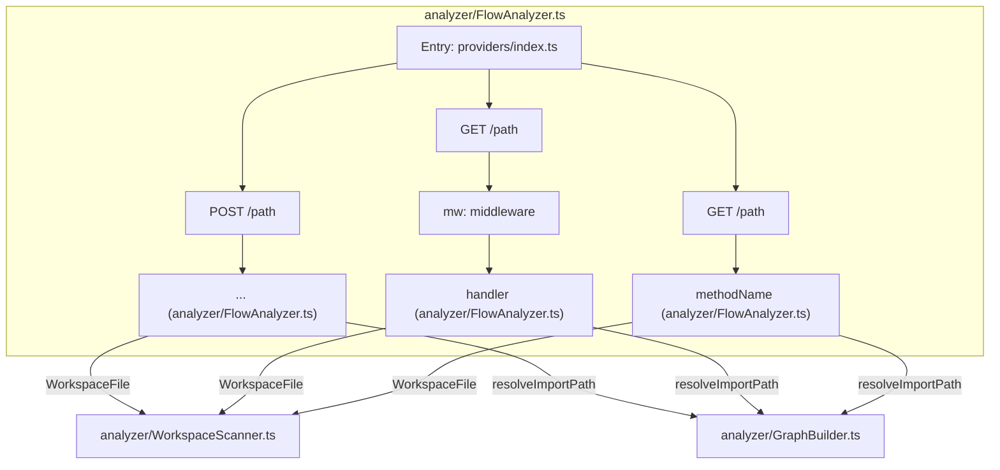

# RepoGraph-AI: RepoGraph Context
> Generated 2026-10-21 by RepoGraph AI. Paste this whole file to any coding agent (Copilot, Cursor, Claude) instead of letting it re-scan the repo.


## Tech stack
- TypeScript/JavaScript

## Entry points
- `src/providers/index.ts`
- `src/agents/index.ts`
- `src/panel/webview/index.ts`

## Top files (purpose + exports)
- `src/panel/handlers/PanelState.ts`: Defines PanelState (used by 7 other files) (exports: PanelState)
- `src/agents/FlowDiagramAgent.ts`: Shared type definitions: FlowSubDiagram, FlowCategory, FullFlowMap, FunctionFlowResult (used by 6 other files) (exports: FlowSubDiagram, FlowCategory, FullFlowMap, normalizeSequence, normalizeMermaid, buildStaticFlowMap, buildSequenceDiagram, buildClassDiagram)
- `src/providers/types.ts`: Shared type definitions: Message, ProviderConfig, AIProvider (used by 11 other files) (exports: Message, ProviderConfig, AIProvider)
- `src/panel/handlers/HistoryHandler.ts`: Defines HistoryHandler (exports: AnalysisRecord, HistoryHandler)
- `src/analyzer/WorkspaceScanner.ts`: Shared type definitions: WorkspaceFile, WorkspaceInfo (used by 10 other files) (exports: WorkspaceFile, WorkspaceInfo)
- `src/analyzer/GraphBuilder.ts`: Shared type definitions: GraphNode, GraphEdge, EdgeConfidence, SymbolNode (used by 10 other files) (exports: GraphNode, GraphEdge, EdgeConfidence, SymbolNode, TypedEdge, GraphCommunity, GraphHealth, DependencyGraph)
- `src/panel/handlers/AnalysisHandler.ts`: Defines AnalysisHandler (exports: AnalysisHandler)
- `src/agents/FileSummaryAgent.ts`: Shared type definitions: FileSummary (used by 7 other files) (exports: FileSummary, selectTopFiles, buildHeuristicSummaries, buildHeuristicSummary, Foo, Bar)
- `src/agents/RepoSummaryAgent.ts`: Shared type definitions: RepoSummary (used by 7 other files) (exports: RepoSummary, isSourceLanguage, countSourceFiles, detectTechStack, buildHeuristicRepoSummary)
- `src/panel/handlers/SettingsHandler.ts`: Defines SettingsHandler (exports: ProviderSettings, SettingsHandler)

## Provenance
EXTRACTED 84 · INFERRED 0 · AMBIGUOUS 0

## God nodes (change risk)
- `src/panel/RepoGraphPanel.ts`
- `src/panel/handlers/PanelState.ts`
- `src/agents/FlowDiagramAgent.ts`
- `src/providers/types.ts`
- `src/analyzer/WorkspaceScanner.ts`
- `src/analyzer/GraphBuilder.ts`
- `src/agents/FileSummaryAgent.ts`
- `src/agents/RepoSummaryAgent.ts`
- `src/panel/handlers/HistoryHandler.ts`
- `src/panel/handlers/AnalysisHandler.ts`

## Key symbols (file:line)
- `src/panel/RepoGraphPanel.ts`: RepoGraphPanel(class:28)
- `src/panel/handlers/PanelState.ts`: PanelState(class:12)
- `src/agents/FlowDiagramAgent.ts`: autoDetectFlows(function:53), generateCustomFlow(function:72), normalizeSequence(function:218), normalizeMermaid(function:228), buildStaticFlowMap(function:352), buildSequenceDiagram(function:743)
- `src/providers/types.ts`: Message(interface:1), ProviderConfig(interface:6), AIProvider(interface:13)
- `src/analyzer/WorkspaceScanner.ts`: scanWorkspace(function:56), WorkspaceFile(interface:4), WorkspaceInfo(interface:12)
- `src/analyzer/GraphBuilder.ts`: resolveImportPath(function:349), extractSymbols(function:360), detectCommunities(function:420), getGodNodes(function:452), getBlastRadius(function:460), diagnoseGraph(function:488)
- `src/agents/FileSummaryAgent.ts`: selectTopFiles(function:79), summarizeFiles(function:93), summarizeOneFile(function:190), buildHeuristicSummaries(function:207), buildHeuristicSummary(function:220), FileSummary(interface:5)
- `src/agents/RepoSummaryAgent.ts`: summarizeRepo(function:14), isSourceLanguage(function:79), countSourceFiles(function:83), detectTechStack(function:110), buildHeuristicRepoSummary(function:179)

## Dependencies (60 shown of 84)
`from -> to` means "from imports to".
- `src/panel/RepoGraphPanel.ts` -> `src/panel/handlers/PanelState.ts` ({ PanelState })
- `src/panel/RepoGraphPanel.ts` -> `src/agents/FlowDiagramAgent.ts` ({ buildStaticFlowMap, annotateWithHealth, buildGuidedTour })
- `src/panel/handlers/PanelState.ts` -> `src/agents/FlowDiagramAgent.ts` ({ FullFlowMap })
- `src/panel/RepoGraphPanel.ts` -> `src/panel/handlers/AnalysisHandler.ts` ({ AnalysisHandler })
- `src/panel/RepoGraphPanel.ts` -> `src/panel/handlers/HistoryHandler.ts` ({ HistoryHandler })
- `src/panel/RepoGraphPanel.ts` -> `src/analyzer/WorkspaceScanner.ts` ({ scanWorkspace })
- `src/panel/RepoGraphPanel.ts` -> `src/analyzer/GraphBuilder.ts` ({)
- `src/panel/RepoGraphPanel.ts` -> `src/agents/RepoSummaryAgent.ts` ({ buildHeuristicRepoSummary })
- `src/panel/RepoGraphPanel.ts` -> `src/agents/FileSummaryAgent.ts` ({ buildHeuristicSummaries })
- `src/panel/handlers/PanelState.ts` -> `src/providers/types.ts` ({ AIProvider })
- `src/panel/handlers/PanelState.ts` -> `src/analyzer/WorkspaceScanner.ts` ({ WorkspaceInfo })
- `src/panel/handlers/PanelState.ts` -> `src/analyzer/GraphBuilder.ts` ({ DependencyGraph })
- `src/panel/handlers/PanelState.ts` -> `src/agents/RepoSummaryAgent.ts` ({ RepoSummary })
- `src/panel/handlers/PanelState.ts` -> `src/agents/FileSummaryAgent.ts` ({ FileSummary })
- `src/panel/handlers/HistoryHandler.ts` -> `src/panel/handlers/PanelState.ts` ({ PanelState })
- `src/panel/handlers/AnalysisHandler.ts` -> `src/panel/handlers/PanelState.ts` ({ PanelState })
- `src/panel/handlers/PanelState.ts` -> `src/agents/QAAgent.ts` ({ QAAgent })
- `src/agents/FlowDiagramAgent.ts` -> `src/providers/types.ts` ({ AIProvider })
- `src/panel/RepoGraphPanel.ts` -> `src/analyzer/FlowAnalyzer.ts` ({ analyzeFlows })
- `src/agents/FlowDiagramAgent.ts` -> `src/analyzer/WorkspaceScanner.ts` ({ WorkspaceInfo })
- `src/agents/FlowDiagramAgent.ts` -> `src/agents/RepoSummaryAgent.ts` ({ RepoSummary })
- `src/agents/FlowDiagramAgent.ts` -> `src/agents/FileSummaryAgent.ts` ({ FileSummary })
- `src/agents/FlowDiagramAgent.ts` -> `src/analyzer/GraphBuilder.ts` ({ SymbolNode })
- `src/panel/handlers/PanelState.ts` -> `src/analyzer/FlowAnalyzer.ts` ({ FlowContext })
- `src/panel/handlers/HistoryHandler.ts` -> `src/agents/FlowDiagramAgent.ts` ({ FullFlowMap })
- `src/panel/handlers/AnalysisHandler.ts` -> `src/agents/FlowDiagramAgent.ts` ({ autoDetectFlows, buildStaticFlowMap, annotateWithHealth, b)
- `src/agents/FileSummaryAgent.ts` -> `src/providers/types.ts` ({ AIProvider })
- `src/agents/RepoSummaryAgent.ts` -> `src/providers/types.ts` ({ AIProvider })
- `src/agents/FileSummaryAgent.ts` -> `src/analyzer/WorkspaceScanner.ts` ({ WorkspaceFile })
- `src/agents/FileSummaryAgent.ts` -> `src/analyzer/GraphBuilder.ts` ({ GraphNode })
- `src/agents/QAAgent.ts` -> `src/providers/types.ts` ({ AIProvider, Message })
- `src/agents/RepoSummaryAgent.ts` -> `src/analyzer/WorkspaceScanner.ts` ({ WorkspaceInfo })
- `src/agents/RepoSummaryAgent.ts` -> `src/analyzer/GraphBuilder.ts` ({ DependencyGraph })
- `src/panel/RepoGraphPanel.ts` -> `src/panel/handlers/SettingsHandler.ts` ({ SettingsHandler })
- `src/panel/handlers/HistoryHandler.ts` -> `src/analyzer/GraphBuilder.ts` ({ DependencyGraph, buildLayerGroups })
- `src/panel/handlers/HistoryHandler.ts` -> `src/agents/RepoSummaryAgent.ts` ({ RepoSummary })
- `src/panel/handlers/HistoryHandler.ts` -> `src/agents/FileSummaryAgent.ts` ({ FileSummary })
- `src/panel/handlers/HistoryHandler.ts` -> `src/analyzer/WorkspaceScanner.ts` ({ scanWorkspace })
- `src/panel/handlers/AnalysisHandler.ts` -> `src/analyzer/WorkspaceScanner.ts` ({ scanWorkspace })
- `src/panel/handlers/AnalysisHandler.ts` -> `src/analyzer/GraphBuilder.ts` ({ buildDependencyGraph, buildLayerGroups, buildGraphReport })
- `src/panel/handlers/AnalysisHandler.ts` -> `src/agents/RepoSummaryAgent.ts` ({ summarizeRepo, buildHeuristicRepoSummary })
- `src/panel/handlers/AnalysisHandler.ts` -> `src/agents/FileSummaryAgent.ts` ({ summarizeFiles, buildHeuristicSummaries })
- `src/panel/handlers/AnalysisHandler.ts` -> `src/panel/handlers/HistoryHandler.ts` ({ HistoryHandler, AnalysisRecord })
- `src/agents/QAAgent.ts` -> `src/analyzer/WorkspaceScanner.ts` ({ WorkspaceInfo })
- `src/agents/QAAgent.ts` -> `src/analyzer/GraphBuilder.ts` ({ DependencyGraph })
- `src/agents/QAAgent.ts` -> `src/agents/RepoSummaryAgent.ts` ({ RepoSummary })
- `src/agents/FlowDiagramAgent.ts` -> `src/analyzer/FlowAnalyzer.ts` ({ FlowContext, CallChain })
- `src/panel/RepoGraphPanel.ts` -> `src/panel/handlers/FileHandler.ts` ({ FileHandler })
- `src/panel/RepoGraphPanel.ts` -> `src/panel/handlers/FlowHandler.ts` ({ FlowHandler })
- `src/panel/RepoGraphPanel.ts` -> `src/analyzer/GraphCache.ts` ({)
- `src/panel/handlers/SettingsHandler.ts` -> `src/panel/handlers/PanelState.ts` ({ PanelState })
- `src/panel/handlers/HistoryHandler.ts` -> `src/agents/QAAgent.ts` ({ QAAgent })
- `src/panel/handlers/AnalysisHandler.ts` -> `src/agents/QAAgent.ts` ({ QAAgent })
- `src/providers/index.ts` -> `src/providers/types.ts` ({ ProviderConfig, AIProvider })
- `src/panel/RepoGraphPanel.ts` -> `src/panel/handlers/ExportHandler.ts` ({ ExportHandler })
- `src/panel/handlers/FlowHandler.ts` -> `src/panel/handlers/PanelState.ts` ({ PanelState })
- `src/panel/handlers/FileHandler.ts` -> `src/panel/handlers/PanelState.ts` ({ PanelState })
- `src/analyzer/FlowAnalyzer.ts` -> `src/analyzer/WorkspaceScanner.ts` ({ WorkspaceFile })
- `src/analyzer/FlowAnalyzer.ts` -> `src/analyzer/GraphBuilder.ts` ({ resolveImportPath })
- `src/extension.ts` -> `src/panel/RepoGraphPanel.ts` ({ RepoGraphPanel })

## Routes (3)
- POST /path → ... (src/analyzer/FlowAnalyzer.ts)
- GET /path → handler [mw: middleware] (src/analyzer/FlowAnalyzer.ts)
- GET /path → methodName (src/analyzer/FlowAnalyzer.ts)

## Call chains (sample)
- analyzer/FlowAnalyzer.ts → analyzer/WorkspaceScanner.ts via WorkspaceFile
- analyzer/FlowAnalyzer.ts → analyzer/GraphBuilder.ts via resolveImportPath
- analyzer/GraphCache.ts → analyzer/GraphBuilder.ts via DependencyGraph
- analyzer/GraphCache.ts → analyzer/WorkspaceScanner.ts via WorkspaceFile
- agents/FileSummaryAgent.ts → providers/types.ts via AIProvider
- agents/FileSummaryAgent.ts → analyzer/WorkspaceScanner.ts via WorkspaceFile
- agents/FileSummaryAgent.ts → analyzer/GraphBuilder.ts via GraphNode
- agents/index.ts → agents/RepoSummaryAgent.ts via summarizeRepo
- agents/index.ts → agents/FileSummaryAgent.ts via summarizeFiles
- agents/index.ts → agents/QAAgent.ts via QAAgent
- agents/index.ts → agents/FlowDiagramAgent.ts via autoDetectFlows
- agents/index.ts → agents/FlowDiagramAgent.ts via generateCustomFlow
- agents/index.ts → agents/FlowDiagramAgent.ts via normalizeMermaid
- agents/QAAgent.ts → providers/types.ts via AIProvider
- agents/QAAgent.ts → providers/types.ts via Message

## Data access
- agents/FlowDiagramAgent.ts: typeorm → query
- handlers/SettingsHandler.ts: sequelize → State
- handlers/HistoryHandler.ts: sequelize → State
- handlers/AnalysisHandler.ts: sequelize → State

## Events
- 03-flow-diagrams.md emits 'name' → [03-flow-diagrams.md]

## Middleware
- 03-flow-diagrams.md: mw, ...
- FlowAnalyzer.ts: middleware, cors, authMw

## Flows (mermaid)

### RepoGraph-AI Data Flow
Complete map of how data travels: entry, all detected routes, handler files, next-hop files, data layer. Static analysis, no guessing.

Related: `src/providers/index.ts`, `src/analyzer/FlowAnalyzer.ts`, `src/analyzer/WorkspaceScanner.ts`, `src/analyzer/GraphBuilder.ts`

## File tree (first 50)
```
tsconfig.json
package.json
scripts/build-webview.js
CHANGELOG.md
tmp-webview.js
docs/09-analysis-pipeline.md
docs/03-flow-diagrams.md
docs/01-architecture.md
docs/06-ai-tools.md
docs/07-settings-providers.md
docs/10-design-ui.md
docs/02-graph.md
docs/README.md
docs/08-history.md
docs/05-qa.md
docs/04-summary.md
CONTRIBUTING.md
README.md
src/analyzer/GraphCache.ts
src/analyzer/WorkspaceScanner.ts
src/analyzer/FlowAnalyzer.ts
src/analyzer/GraphBuilder.ts
src/analyzer/RepoFetcher.ts
src/agents/FileSummaryAgent.ts
src/agents/index.ts
src/agents/QAAgent.ts
src/providers/GroqProvider.ts
src/providers/GeminiProvider.ts
src/providers/index.ts
src/agents/FlowDiagramAgent.ts
src/providers/types.ts
src/agents/RepoSummaryAgent.ts
src/providers/OllamaProvider.ts
src/providers/AnthropicProvider.ts
src/providers/OpenAIProvider.ts
src/extension.ts
src/panel/RepoGraphPanel.ts
src/panel/webview/index.ts
src/panel/webview/scripts/graph.js
src/panel/webview/scripts/ui.js
src/panel/webview/scripts/messaging.js
src/panel/webview/scripts/flow.js
src/panel/webviewContent.ts
src/panel/handlers/PanelState.ts
src/panel/handlers/SettingsHandler.ts
src/panel/handlers/HistoryHandler.ts
src/panel/handlers/FlowHandler.ts
src/panel/handlers/ExportHandler.ts
src/panel/handlers/FileHandler.ts
src/panel/handlers/AnalysisHandler.ts
```

---
Note for agents: imports above are a static-analysis snapshot, not verified ground truth. Cross-check by reading source files before refactoring. Ask the user for a file path to read full source when needed.